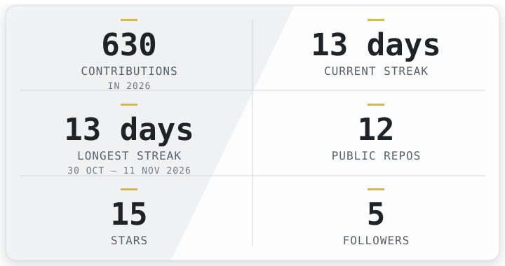
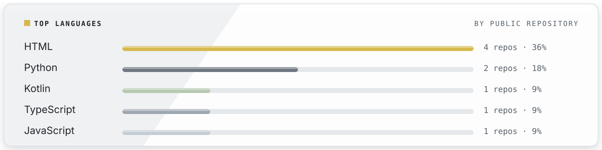

  <a href="https://asmitsr.vercel.app">Portfolio</a> · <a href="https://github.com/asmitsr">GitHub</a> · <a href="https://www.linkedin.com/in/asmit-sarkar-4028bb449/">LinkedIn</a> · <a href="mailto:asmitsr.official@gmail.com">Email</a>

## About Me

I'm Asmit Sarkar, a Web & Android Developer based in Chattogram, Bangladesh. I enjoy turning ideas into useful digital experiences — building web applications and Android apps that solve real problems. I'm currently focused on learning programming and coding, with a growing interest in cyber security.

## Tech Stack

### Languages

### Frameworks & Runtime

### Tools

## GitHub Analytics

_Statistics update daily from GitHub._

## Featured Projects

<table>
  <tr>
    <td><a href="https://teamforge-mu.vercel.app"><b>TeamForge</b></a> Race-proof team formation for hackathons</td>
    <td><a href="https://github.com/asmitsr/DoremanAI"><b>DoremanAI</b></a> Android voice-controlled personal assistant</td>
  </tr>
  <tr>
    <td><a href="https://secret-recipe-phi.vercel.app"><b>Secret Recipe</b></a> Website for Secret Recipe Bangladesh</td>
    <td><a href="https://ctgresult.vercel.app"><b>Board Rank</b></a> Chattogram Board HSC 2026 rank list</td>
  </tr>
  <tr>
    <td><a href="https://github.com/asmitsr/asmit-mcp-server"><b>asmit-mcp-server</b></a> MCP server with 12 tools</td>
    <td><a href="https://showcase-topaz-seven.vercel.app/"><b>SUST OR DIE</b></a> Personal study-planner Android app</td>
  </tr>
</table>

  © 2026 Asmit Sarkar

