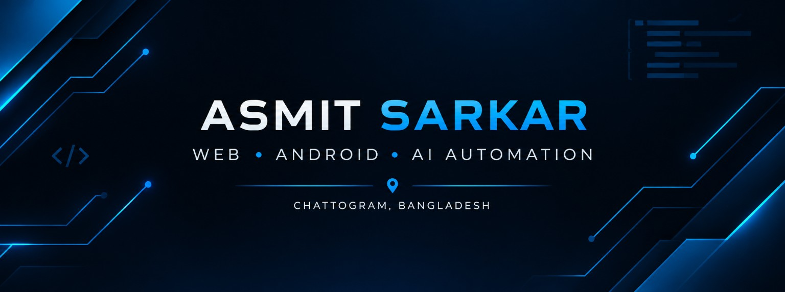

  

<h1 align="center">Hi 👋, I'm Asmit Sarkar</h1>

<h3 align="center">
  Web Development • Android • AI & Automation
</h3>

  Building useful applications, learning new technologies,
  and turning ideas into real-world projects.

  📍 Chattogram, Bangladesh

  

---

## 👨‍💻 About Me

- 🌐 Interested in Web Development
- 📱 Exploring Android App Development
- 🤖 Learning AI and Automation
- 🛠️ Building practical projects
- 📚 Improving my coding and problem-solving skills

---

## 🧰 Technologies & Tools

  
  
  
  
  
  
  

---

## 🚀 Featured Projects

### 🤖 SnehaAI
Exploring AI-powered applications and intelligent digital experiences.

[View Repository →](https://github.com/asmitsr/SnehaAI)

### 📱 Minimal Launcher
An Android launcher focused on a clean, minimal user experience.

[View Repository →](https://github.com/asmitsr/minimal-launcher)

### 📚 HSC Tracker
A study-focused project for tracking HSC syllabus progress.

[View Repository →](https://github.com/asmitsr/hsc-tracker)

### ❤️ Aksharoloy
A personal project dedicated to my mother.

[View Repository →](https://github.com/asmitsr/Aksharoloy)

---

## 📊 GitHub Statistics

  

  

  

---

## 🎯 Current Focus

- Building useful and user-friendly applications
- Exploring AI-powered automation
- Writing cleaner, maintainable code
- Improving problem-solving skills
- Turning ideas into polished projects

---

## 🤝 Connect With Me

  

📍 Chattogram, Bangladesh

---

  <b>Build. Learn. Improve. Repeat.</b>

  ⭐ Thanks for visiting my profile!

