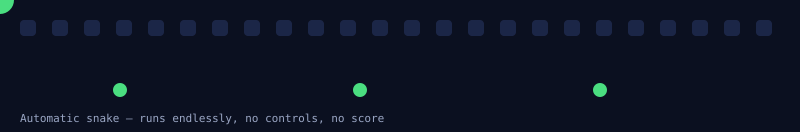

# Asmit Sarkar

**Aspiring Developer | Web & Android Development | AI Automation | Building useful digital experiences.**

📍 Chattogram, Bangladesh

## Stats — verified snapshot, 2 November 2026

| Contributions (last year) | Current streak | Longest streak | Public repositories | Stars | Followers |
|---:|---:|---:|---:|---:|---:|
| 261 | 4 days (30 Oct – 2 Nov 2026) | 7 days (10 – 16 Oct 2026) | 10 | 8 | 1 |

Total repositories: 13 (10 public + 3 private; private repositories are not listed by name here).

**How these numbers were checked, so nothing is invented:**
- Contributions 261 is GitHub's own native figure for the last year (2 Nov 2025 – 2 Nov 2026), cross-checked on 2 Nov 2026 with the streak-stats service, which showed the same 261.
- GitHub itself does not display a streak figure. The streak figures above are counted from the GitHub contribution calendar, including private contributions, as shown by streak-stats on 2 Nov 2026. They are not presented as a figure GitHub itself displays.
- Public repositories 10, stars 8 and followers 1 were checked live via the GitHub connector on 2 Nov 2026.
- These are a snapshot. They will change as new contributions are made.

## Snake — automatic, no game controls

The snake above runs automatically and endlessly. It is decoration only — there is no playable game, no score, and no controls in this README, because a GitHub README cannot run an interactive game.

## Selected work — public repositories only

- **[DoremanAI](https://github.com/asmitsr/DoremanAI)** — Kotlin — AI-powered Android voice assistant.
- **[SUST OR DIE](https://github.com/asmitsr/sust-or-die)** — Kotlin — Personal admission study app, 60-day SUST / GST / CoU A-unit plan.
- **[Skill DNA](https://github.com/asmitsr/skill-dna)** — HTML — GitHub skill analyzer.
- **[IELTS Pathway](https://github.com/asmitsr/ielts-pathway)** — HTML — 60-day IELTS planner.
- **[Akshoraloy](https://github.com/asmitsr/Akshoraloy)** — Kotlin — My very first project, dedicated to my mother, who has always supported and believed in me.
- **[HSC Tracker](https://github.com/asmitsr/hsc-tracker)** — HTML — HSC syllabus tracker.
- **[Minimal Launcher](https://github.com/asmitsr/minimal-launcher)** — Android launcher.
- **[Reader-Calculator](https://github.com/asmitsr/Reader-Calculator)** — Tool.
- **[reporevive-security-scanner](https://github.com/asmitsr/reporevive-security-scanner)** — Security scanner.
- **[asmitsr](https://github.com/asmitsr/asmitsr)** — This profile repository.

## System info

- **Focus:** Web & Android development, AI automation
- **Main languages in public work:** Kotlin, HTML
- **Location:** Chattogram, Bangladesh

## Contact

- GitHub: [github.com/asmitsr](https://github.com/asmitsr)
- Email: [asmitsr.official@gmail.com](mailto:asmitsr.official@gmail.com)
