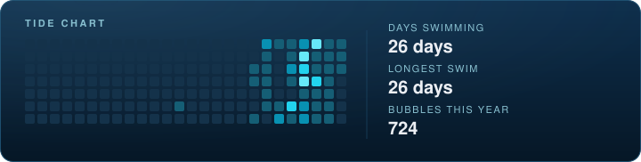

<em>Every fish is one of my repositories; the big ones have the most stars.</em>

<table>
  <tr>
    <td style="background:#192A40;border:1px solid #344358;border-radius:12px;padding:20px 22px;">
      
TANK KEEPER

      
Asmit Sarkar

      
Aspiring Developer | Web &amp; Android Development | AI Automation | Building useful digital experiences.

      
📍 Chattogram, Bangladesh · 6 followers · 13 repositories · ★ 14 stars

    </td>
    <td style="background:#192A40;border:1px solid #344358;border-radius:12px;padding:20px;" align="center" width="140">
      
    </td>
  </tr>
</table>

<table>
  <tr>
    <td style="background:#192A40;border:1px solid #344358;border-radius:12px;padding:18px 20px;" width="50%">
      
SPECIMEN 01

      
🐠 <a href="https://github.com/asmitsr/DoremanAI" style="color:#F4F3EF;text-decoration:none;font-weight:700;">DoremanAI</a>

      
Android voice-controlled personal assistant (Kotlin, single AI gateway)

      
★ 3 &nbsp;⑂ 0 &nbsp;&nbsp;● Kotlin

    </td>
    <td style="background:#192A40;border:1px solid #344358;border-radius:12px;padding:18px 20px;" width="50%">
      
SPECIMEN 02

      
🐠 <a href="https://github.com/asmitsr/asmit-mcp-server" style="color:#F4F3EF;text-decoration:none;font-weight:700;">asmit-mcp-server</a>

      
MCP server with 12 tools

      
★ 2 &nbsp;⑂ 0 &nbsp;&nbsp;● Python

    </td>
  </tr>
</table>

  
WATER CHEMISTRY

  <table style="width:100%;margin-top:10px;">
    <tr>
      <td style="color:#F4F3EF;font-size:14px;" width="130">● HTML</td>
      <td>

</td>
      <td style="color:#A7B2C2;font-size:14px;" align="right" width="48">86%</td>
    </tr>
    <tr>
      <td style="color:#F4F3EF;font-size:14px;" width="130">● Kotlin</td>
      <td>

</td>
      <td style="color:#A7B2C2;font-size:14px;" align="right" width="48">6%</td>
    </tr>
    <tr>
      <td style="color:#F4F3EF;font-size:14px;" width="130">● TypeScript</td>
      <td>

</td>
      <td style="color:#A7B2C2;font-size:14px;" align="right" width="48">5%</td>
    </tr>
    <tr>
      <td style="color:#F4F3EF;font-size:14px;" width="130">● JavaScript</td>
      <td>

</td>
      <td style="color:#A7B2C2;font-size:14px;" align="right" width="48">1%</td>
    </tr>
    <tr>
      <td style="color:#F4F3EF;font-size:14px;" width="130">● PLpgSQL</td>
      <td>

</td>
      <td style="color:#A7B2C2;font-size:14px;" align="right" width="48">1%</td>
    </tr>
  </table>

  
TIDE CHART

  <table style="width:100%;margin-top:12px;">
    <tr>
      <td valign="top"></td>
      <td valign="top" style="padding-left:24px;">
        
DAYS SWIMMING

        
26 days

        
30 Oct – 24 Nov 2026

        
LONGEST SWIM

        
26 days

        
BUBBLES THIS YEAR

        
724

      </td>
    </tr>
  </table>

<a href="https://github.com/asmitsr">GitHub</a> · <a href="https://asmitsr.vercel.app">Website</a>

🐠 fish are repos · seaweed is contributions · bubbles are the last 30 days

