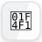

I'm Asmit Sarkar, a Web & Android Developer based in Chattogram, Bangladesh. I enjoy turning ideas into useful digital experiences — building web applications and Android apps that solve real problems. I'm currently focused on learning programming and coding, with a growing interest in cyber security.

## Tech Stack

### Languages

### Frameworks & Runtime

### Tools

## GitHub Analytics

_Statistics update daily from GitHub._

<table>
  <tr>
    <td>🚀 <b>Future Projects</b>  <b>asmit-mcp-server</b> MCP server with 12 tools <a href="https://github.com/asmitsr/asmit-mcp-server">View on GitHub →</a></td>
  </tr>
</table>

<table>
  <tr>
    <td> <b>TeamForge</b> Race-proof team formation for hackathons <a href="https://teamforge-mu.vercel.app">Visit Website →</a></td>
    <td> <b>Secret Recipe</b> Website for Secret Recipe Bangladesh <a href="https://secret-recipe-phi.vercel.app">Visit Website →</a></td>
  </tr>
  <tr>
    <td> <b>Board Rank</b> Chattogram Board HSC 2026 rank list <a href="https://ctgresult.vercel.app">Visit Website →</a></td>
    <td> <b>Showcase</b> Public showcase of my projects <a href="https://showcase-topaz-seven.vercel.app/">Visit Website →</a></td>
  </tr>
  <tr>
    <td> <b>Portfolio</b> My personal portfolio website <a href="https://asmitsr.vercel.app">Visit Website →</a></td>
    <td> <b>Expense Splitter</b> Split expenses with friends <a href="https://expense-splitter-lovat-iota.vercel.app/">Visit Website →</a></td>
  </tr>
  <tr>
    <td> <b>Skill DNA</b> GitHub skill analyzer — verifiable skill evidence <a href="https://skill-dna-vert.vercel.app">Visit Website →</a></td>
    <td> <b>IELTS Pathway</b> IELTS preparation site with a 60-day planner <a href="https://ielts-pathway-fccu.vercel.app">Visit Website →</a></td>
  </tr>
  <tr>
    <td> <b>Password Leak Checker</b> Check if a password or email appeared in data breaches <a href="https://password-leak-checker.vercel.app">Visit Website →</a></td>
    <td> <b>Lumen Garden</b> Canvas arcade game — defend the garden, chase your best score <a href="https://lumen-garden-y1ra.vercel.app">Visit Website →</a></td>
  </tr>
  <tr>
    <td> <b>HSC Result Checker</b> HSC results and full marksheet in one site <a href="https://hsc-result-checker.vercel.app">Visit Website →</a></td>
    <td> <b>HSC Tracker</b> HSC syllabus tracker <a href="https://hsc-tracker-three.vercel.app/">Visit Website →</a></td>
  </tr>
  <tr>
    <td> <b>DoremanAI</b> Android voice-controlled personal assistant <a href="https://github.com/asmitsr/DoremanAI/releases/tag/latest-apk">Download APK ↓</a></td>
    <td> <b>SUST OR DIE</b> Personal study-planner Android app <a href="https://raw.githubusercontent.com/asmitsr/showcase/main/sust-or-die.apk">Download APK ↓</a></td>
  </tr>
  <tr>
    <td> <b>Akshoraloy</b> Library app — my very first project <a href="https://raw.githubusercontent.com/asmitsr/showcase/main/akshoraloy.apk">Download APK ↓</a></td>
    <td> <b>Minimal Launcher</b> Minimal Android launcher <a href="https://raw.githubusercontent.com/asmitsr/showcase/main/minimal-launcher.apk">Download APK ↓</a></td>
  </tr>
  <tr>
    <td> <b>Chattogram Puja</b> Durga Puja pandal guide, interactive map & schedule <a href="https://chattogram-puja.vercel.app">Visit Website →</a></td>
  </tr>
</table>

  <a href="https://asmitsr.vercel.app">Portfolio</a> · <a href="https://github.com/asmitsr">GitHub</a> · <a href="https://www.linkedin.com/in/asmit-sarkar-4028bb449/">LinkedIn</a> · <a href="mailto:asmitsr.official@gmail.com">Email</a>

  © 2026 Asmit Sarkar

