

<!-- ═══════════════════════════════════════════════════════════════════════════
     HERO BANNER (Custom Animated SVG + Embedded AI Portrait)
     ═══════════════════════════════════════════════════════════════════════════ -->

 

  

<!-- ═══════════════════════════════════════════════════════════════════════════
     01 · ABOUT ME
     ═══════════════════════════════════════════════════════════════════════════ -->
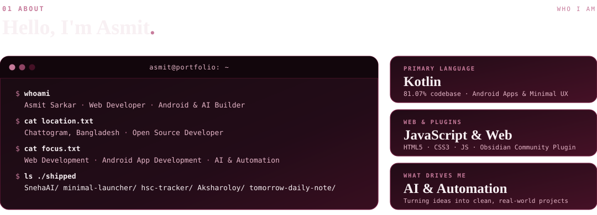

  

<!-- ═══════════════════════════════════════════════════════════════════════════
     02 · RECOGNITION & MILESTONES
     ═══════════════════════════════════════════════════════════════════════════ -->

  

<!-- ═══════════════════════════════════════════════════════════════════════════
     03 · SELECTED WORK (Products, not assignments.)
     ═══════════════════════════════════════════════════════════════════════════ -->

 

<a href="https://github.com/asmitsr/SnehaAI">
  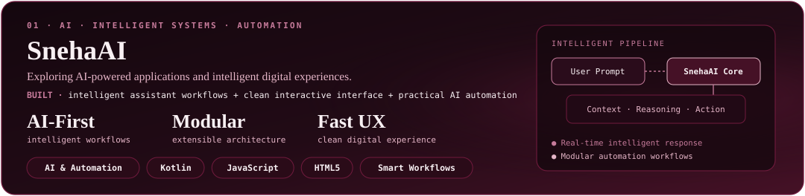
</a>

 

<a href="https://github.com/asmitsr/minimal-launcher">
  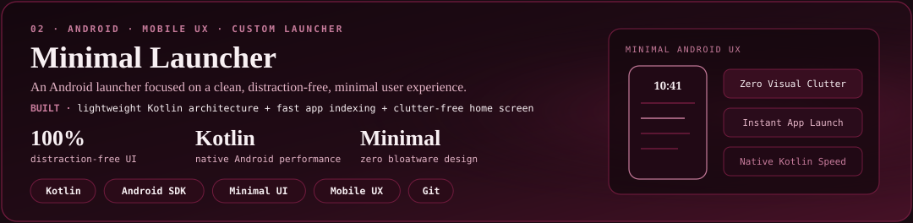
</a>

 

<a href="https://github.com/asmitsr/hsc-tracker">
  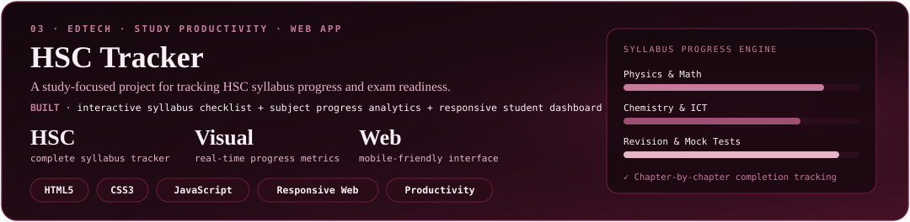
</a>

 

<a href="https://github.com/asmitsr/Aksharoloy">
  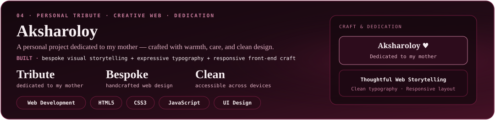
</a>

  

<!-- ═══════════════════════════════════════════════════════════════════════════
     04 · TOOLKIT (The tools I reach for.)
     ═══════════════════════════════════════════════════════════════════════════ -->
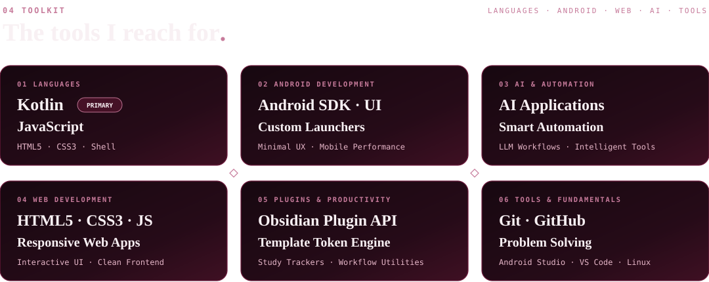

  

<!-- ═══════════════════════════════════════════════════════════════════════════
     05 · COMMIT LOG & GITHUB STATISTICS
     ═══════════════════════════════════════════════════════════════════════════ -->
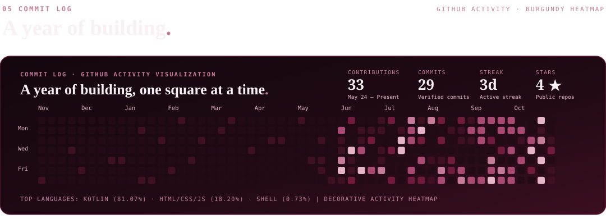

 

<picture>
  
</picture>
<picture>
  
</picture>

  

<!-- ═══════════════════════════════════════════════════════════════════════════
     06 · CONNECT & ANIMATED FOOTER
     ═══════════════════════════════════════════════════════════════════════════ -->

 

 


