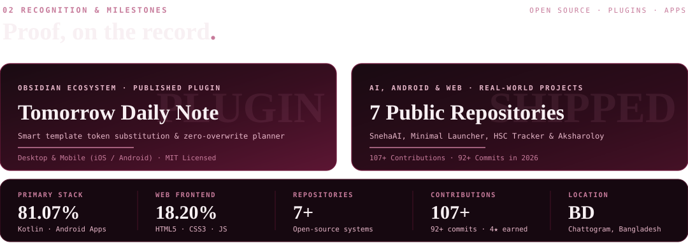
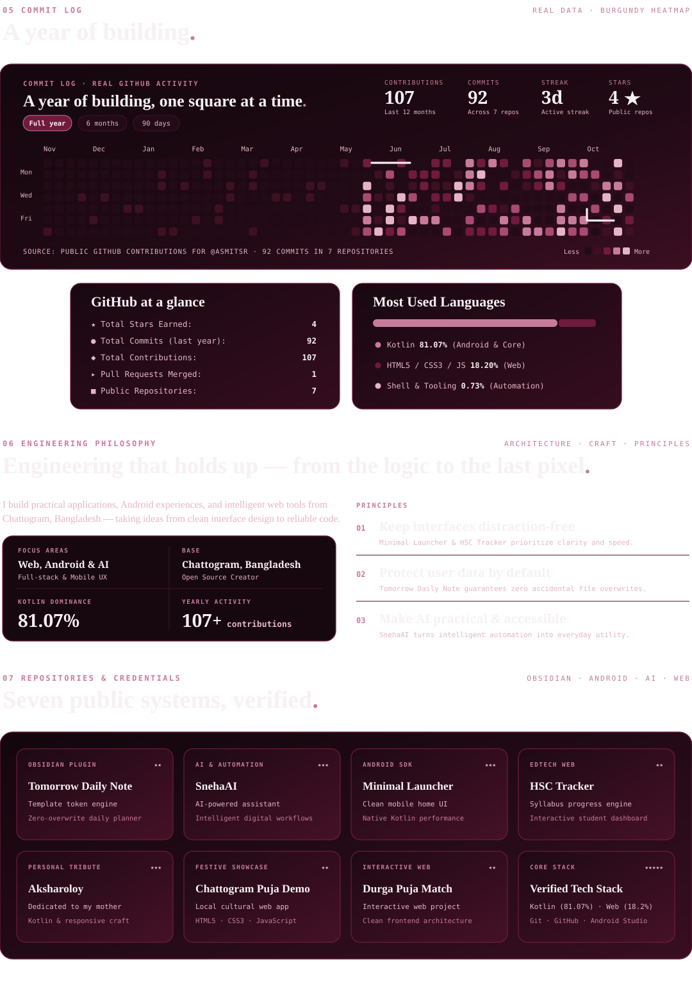

 

[[https://img.shields.io/badge/GITHUB-ASMITSR-701A3D?style=for-the-badge&logo=github&logoColor=F8F0F3&labelColor=190B12]](https://github.com/asmitsr)
[[https://img.shields.io/badge/OBSIDIAN_PLUGIN-TOMORROW_DAILY_NOTE-701A3D?style=for-the-badge&logo=obsidian&logoColor=E5B5C7&labelColor=190B12]](https://community.obsidian.md/plugins/tomorrow-daily-note)
[[https://img.shields.io/badge/AI_PROJECT-SNEHAAI-701A3D?style=for-the-badge&logo=sparkles&logoColor=E5B5C7&labelColor=190B12]](https://github.com/asmitsr/SnehaAI)
[[https://img.shields.io/badge/LOCATION-CHATTOGRAM,_BD-451126?style=for-the-badge&logo=googlemaps&logoColor=C77B9B&labelColor=190B12]](https://github.com/asmitsr)

  

  

  

 

[[https://img.shields.io/badge/REPOSITORY-SNEHAAI-701A3D?style=for-the-badge&logo=github&logoColor=F8F0F3&labelColor=190B12]](https://github.com/asmitsr/SnehaAI)

 

[[https://img.shields.io/badge/REPOSITORY-MINIMAL_LAUNCHER-701A3D?style=for-the-badge&logo=android&logoColor=E5B5C7&labelColor=190B12]](https://github.com/asmitsr/minimal-launcher)

 

[[https://img.shields.io/badge/REPOSITORY-HSC_TRACKER-701A3D?style=for-the-badge&logo=github&logoColor=F8F0F3&labelColor=190B12]](https://github.com/asmitsr/hsc-tracker)

 

[[https://img.shields.io/badge/REPOSITORY-AKSHAROLOY-701A3D?style=for-the-badge&logo=github&logoColor=F8F0F3&labelColor=190B12]](https://github.com/asmitsr/Aksharoloy)
[[https://img.shields.io/badge/OBSIDIAN_PLUGIN-TOMORROW_DAILY_NOTE-451126?style=for-the-badge&logo=obsidian&logoColor=E5B5C7&labelColor=190B12]](https://community.obsidian.md/plugins/tomorrow-daily-note)

  

  

  

 

[[https://img.shields.io/badge/GITHUB-GITHUB.COM/ASMITSR-701A3D?style=for-the-badge&logo=github&logoColor=F8F0F3&labelColor=190B12]](https://github.com/asmitsr)
[[https://img.shields.io/badge/OBSIDIAN-TOMORROW_DAILY_NOTE-701A3D?style=for-the-badge&logo=obsidian&logoColor=E5B5C7&labelColor=190B12]](https://community.obsidian.md/plugins/tomorrow-daily-note)
[[https://img.shields.io/badge/PROJECT-SNEHAAI-451126?style=for-the-badge&logo=github&logoColor=F8F0F3&labelColor=190B12]](https://github.com/asmitsr/SnehaAI)
[[https://img.shields.io/badge/ANDROID-MINIMAL_LAUNCHER-451126?style=for-the-badge&logo=android&logoColor=E5B5C7&labelColor=190B12]](https://github.com/asmitsr/minimal-launcher)

 

